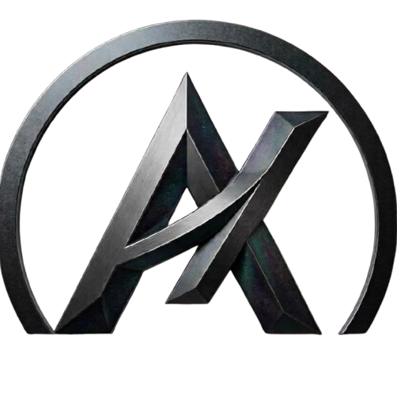
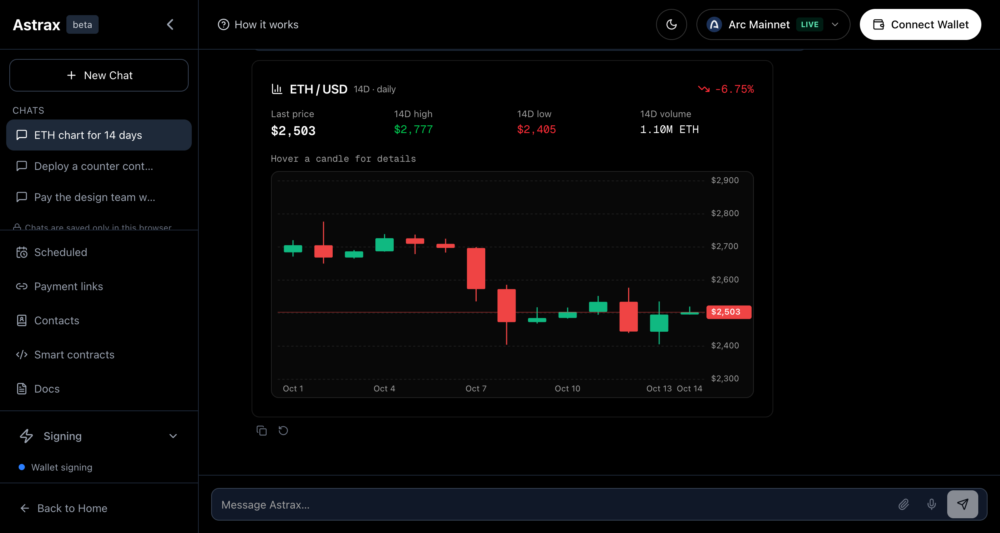
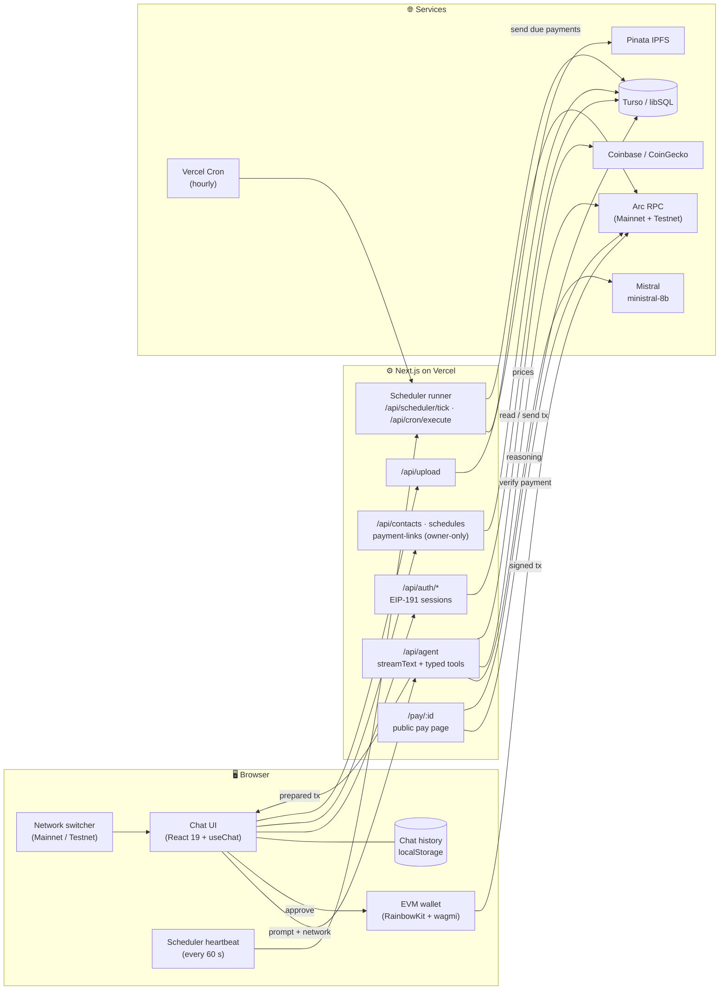
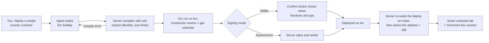
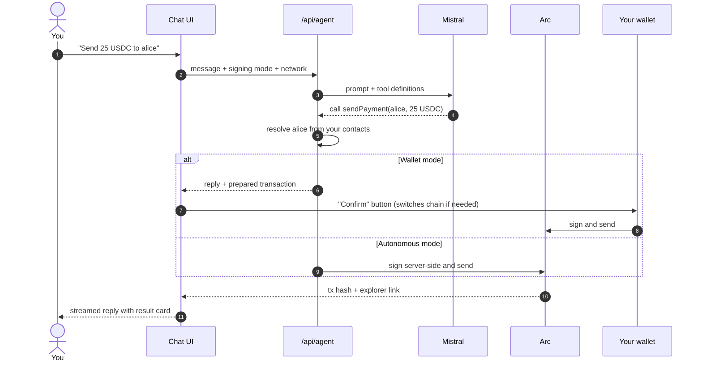
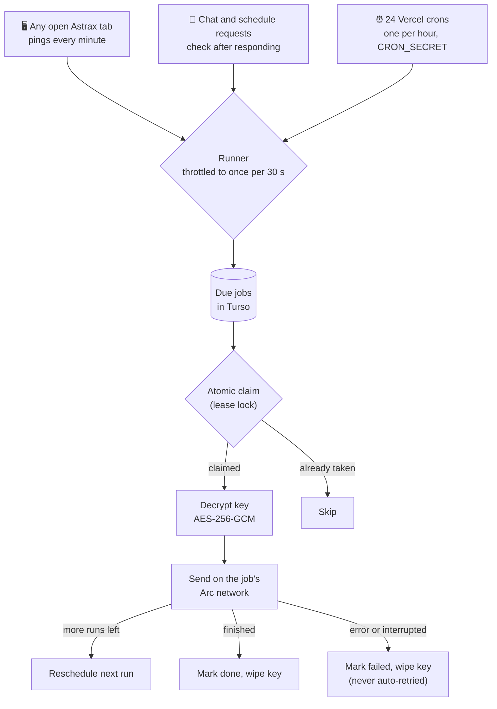
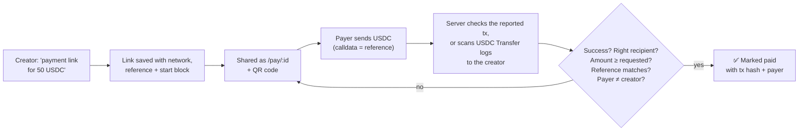

<div align="center">



# Astrax

### Talk to Arc in plain English.

An AI agent that turns a chat message into a real on-chain action on **Arc Mainnet**
and **Arc Testnet**: USDC payments, tokens, NFTs, your own smart contracts, recurring
transfers and self-tracking payment links. You stay in control of every signature.

[Features in depth](FEATURES.md) · [Quick start](#-quick-start) · [Arc docs](https://docs.arc.io)


<br />



</div>

---

## 💡 The problem

Arc makes stablecoin payments simple at the protocol level: USDC is the gas token,
fees are a fraction of a cent and finality is under a second. Using it still means
juggling a wallet, an explorer, a token tool, a spreadsheet of addresses and a calendar
reminder for every recurring payment.

## ✨ The solution

Astrax puts all of it behind one chat box. You say what you want, the agent works out
the steps, calls typed Arc tools, and hands you a transaction to approve, or signs it
for you in hands-free autonomous mode.

```text
"What's my USDC balance?"
"Send 25 USDC to alice"
"Create a token called MoonCoin, symbol MOON, supply 1,000,000"
"Pay the design team 100 USDC every week, 4 times"
"Make a payment link for 50 USDC for logo design"
"Is this token safe? 0x…"
"Create and deploy a simple counter contract"
"Increment the counter"
"What's the count on my counter?"
"Show me the USDC price chart for the last 14 days"
```

---

## 🌐 Networks

Astrax runs on both Arc networks and switches between them at runtime with the
network switcher in the top bar. Balances, payment links, schedules, explorer links and
the agent all follow the selected network, and the connected wallet is asked to switch
too. If you change networks inside your wallet, Astrax follows.

| | Arc Mainnet | Arc Testnet |
|---|---|---|
| **Chain ID** | `5042` | `5042002` |
| **RPC** | `https://rpc.mainnet.arc.io` | `https://rpc.testnet.arc.io` |
| **Explorer** | [explorer.arc.io](https://explorer.arc.io) | [explorer.testnet.arc.io](https://explorer.testnet.arc.io) |
| **Gas token** | USDC | USDC |
| **Funds** | Real USDC, final in under a second | Free test USDC from [faucet.circle.com](https://faucet.circle.com) |

Known tokens (addresses from Circle's Arc docs, verified on-chain): **USDC**
(`0x3600…0000`, the ERC-20 view of the native gas token), **EURC**, **USYC**, **cirBTC**
and **WETH**. Any other ERC-20 works by contract address.

`NEXT_PUBLIC_DEFAULT_NETWORK` sets where first-time visitors land (testnet if unset);
returning users keep their last choice.

---

## 🚀 Features

| | Feature | What it does |
|---|---|---|
| 💸 | **Chat to transact** | Send USDC, EURC or any ERC-20 to an address or a saved contact name. |
| 🪙 | **Create tokens and NFTs** | Deploys an Astrax ERC-20 (you own it and can mint more), or a 1-of-1 ERC-721 from an image you upload (PNG, JPG, GIF or WebP), with standard metadata on IPFS. |
| 🧱 | **Deploy your own smart contracts** | Describe a contract ("a simple counter", "a voting contract", "an escrow") and the agent writes the Solidity, compiles it with `solc` (OpenZeppelin v5 imports work), dry-runs it against the chain and deploys it. Compile errors come back with the failing line so it fixes itself. |
| 🧭 | **Smart contracts tab** | Everything you deployed through Astrax (custom contracts, tokens and NFTs) on the selected network, with live values such as a counter's `count`. Tap a function to prefill a prompt, or just say "increment the counter". |
| 🕹️ | **Call any contract from chat** | Reads answer instantly. Writes are simulated first, so a call that would revert is refused before anything is signed. Payable functions can carry USDC. Contracts Astrax didn't deploy work too, with a function signature. |
| 🗓️ | **Scheduled payments** | One-off or recurring transfers that go out on their own, even after you close the tab. |
| 🔗 | **Self-tracking payment links** | Share a link or QR code. Astrax finds the USDC payment on-chain and marks it paid. |
| 🛡️ | **Explain anything** | Paste a transaction, wallet, token or contract and get a plain-English breakdown with risk flags, including look-alike token warnings. |
| 📈 | **Live market data** | Prices and interactive candlestick charts for USDC, EURC, ETH and BTC, rendered right in the chat. Stablecoins get a tight price scale, so a move from $0.9990 to $1.0020 is actually visible. |
| 📇 | **Contacts** | A private address book per wallet, so "pay alice" always means *your* alice. |
| 🔐 | **Two signing modes** | Approve each transaction in MetaMask, Rabby, Coinbase Wallet or any EVM wallet, or go autonomous with a dedicated private key. |
| 🌐 | **Mainnet + Testnet** | One-click network switcher; every result remembers the network it ran on. |
| 🧠 | **Transparent agent** | Every reply shows the steps and tools it used. Edit, copy or regenerate any message. |
| 🕶️ | **Private chats** | Conversations live only in your browser. Nothing about them is kept on the server. |

Full details for each feature are in [`FEATURES.md`](FEATURES.md).

---

## 🏗️ Architecture

One Next.js app: the UI, the agent and the APIs ship together and deploy to Vercel's
free tier with a free Turso database.



### From a sentence to a deployed contract

The model writes the Solidity; everything after that is deterministic and checked on the
server before your wallet is ever asked to sign.



Afterwards the agent knows your contracts and their functions. A call is parsed against
the stored ABI, simulated, and only then sent, so a write that would revert never costs
you a fee.

### How a chat message becomes a transaction



### Scheduled payments, with no extra services

Vercel's free plan only allows daily crons, so Astrax combines three triggers. Each one
goes through the same runner, which claims every job atomically in the database before
sending, so a payment can never go out twice. Each job remembers its network.



**Result:** payments go out within about a minute while anyone has the app open, and
within the hour otherwise.

### Payment links that track themselves

Each link stores a random 32-byte reference. The pay page sends a plain USDC transfer
to the creator whose calldata is that reference, so the payment can be tied to the link
with no smart contract.



---

## 🧰 Tech stack

| Layer | Technology |
|---|---|
| **Framework** | Next.js 15 (App Router), React 19, TypeScript |
| **AI agent** | Vercel AI SDK 4 (`streamText` with tool calling), Mistral `ministral-8b-latest`, Gemini as fallback |
| **Blockchain** | `viem` on Arc Mainnet (5042) and Arc Testnet (5042002), with Arc's 20 gwei fee floor applied to every transaction |
| **Contracts** | `AstraxToken` (ERC-20) and `AstraxNFT` (1-of-1 ERC-721) in `contracts/`, precompiled into `lib/contracts.ts`; custom contracts compiled on demand with `solc` (OpenZeppelin v5 imports supported) |
| **Wallets** | RainbowKit + wagmi (MetaMask, Rabby, Coinbase Wallet, WalletConnect, any injected wallet) |
| **Database** | libSQL: a local file in development, hosted Turso in production |
| **Storage** | Pinata IPFS for uploads and NFT metadata |
| **Market data** | Coinbase and CoinGecko APIs |
| **Crypto** | AES-256-GCM key encryption, EIP-191 message signatures, HMAC sessions |
| **UI** | Tailwind CSS 4, Framer Motion, Lucide icons, react-markdown, Mermaid diagrams |
| **Hosting** | Vercel (Hobby plan) with Vercel Cron |

---

## 🔒 Security model

- **You choose who signs.** In wallet mode every transaction is approved in your own
  wallet. Autonomous mode is for a dedicated hot wallet with a small balance; on Arc
  Mainnet it moves real USDC, and the app says so before you paste a key.
- **Keys are never stored in plain text.** A key used for scheduled payments is
  encrypted with AES-256-GCM and wiped as soon as the schedule ends or is cancelled.
  Keys are sent in the request body, never in the prompt, and never logged.
- **Your data is yours.** Contacts, payment links and schedules are only shown after you
  prove you own the wallet with a free EIP-191 signed message. Messages are single-use,
  expire in 5 minutes and are bound to the site's domain. Sessions are HttpOnly cookies.
- **No double payments.** Confirmed transactions are remembered across reloads, scheduled
  jobs are claimed atomically, and an interrupted send is never retried.
- **Payments are verified on-chain.** A payment link is only marked paid after the
  server re-reads the transaction from Arc; the payer's browser is never trusted.
- **Contract deployments are verified too.** A deployment is only added to your list after
  the server confirms the transaction deployed exactly the code it compiled, from your
  wallet. The bytecode stays on the server, so the browser can't swap in something else.
- **The compiler is boxed in.** Source can only import `@openzeppelin/contracts/...`
  (never other files on the server), is capped in size, and compiles are rate-limited.
  Writes to contracts are simulated before they are sent.
- **Hardened endpoints.** Uploads accept images only (checked by their real bytes) and,
  like payment reports, are rate-limited. The cron endpoint uses a constant-time secret
  check, and model output is rendered without raw HTML.

---

## 📁 Project structure

```text
app/
  ai-chat/              Chat interface
  pay/[id]/             Public pay page for tracked payment links
  payment-link/         Simple untracked pay page (/payment-link/<address>/<amount>)
  api/
    agent/              The AI agent: streaming + all Arc tools
    auth/               Wallet-ownership sign-in (challenge → verify → session)
    contacts/           Owner-only address book
    contracts/          Owner-only list of deployed contracts (with live values) + remove
    contracts/[id]/     Wallet-mode contract deploys: fetch calldata, confirm on-chain
    payment-links/      List, check, report and cancel payment links
    schedules/          Owner-only scheduled payments
    scheduler/tick/     Throttled runner triggered by open tabs
    cron/execute/       Runner triggered by Vercel Cron
    upload/             Image uploads to IPFS via Pinata
components/             Chat UI, sidebar, network switcher, modals, charts, tx buttons
contexts/               Network, signing mode and owner session state
contracts/              AstraxToken.sol, AstraxNFT.sol
scripts/                compile-contracts.mjs (solc → lib/contracts.ts)
lib/
  arc.ts                Arc networks, clients, fees, tokens, explorer links
  evm.ts                Amounts, transfers, deployments, signing, errors
  wagmi.ts              Browser wallet config
  activity.ts           Recent address activity
  scheduler.ts          Shared, double-send-safe payment runner
  payment-links.ts      On-chain payment detection
  db.ts                 libSQL schema and queries
  auth.ts · crypto.ts   Sessions, signatures, key encryption
  solc.ts · abi-args.ts Solidity compiler for deployContract; ABI argument parsing
  explain.ts            Transaction / address risk analysis
  images.ts · pinata.ts Image checks, IPFS uploads and NFT metadata
```

---

## ⚡ Quick start

```bash
git clone <your-repo-url> Astrax_Arc
cd Astrax_Arc
npm install
cp .env.example .env.local   # add a MISTRAL_API_KEY at minimum
npm run dev
```

Open http://localhost:3000, launch the assistant, pick **Arc Testnet** in the top bar,
and either connect a wallet or paste a private key in the sidebar **Signing** panel.
Grab free test USDC from [faucet.circle.com](https://faucet.circle.com).

Locally the database is a file created automatically. Every variable is documented in
[`.env.example`](.env.example). After editing anything in `contracts/`, run
`npm run compile:contracts`.

<details>
<summary><b>Deploying to Vercel</b></summary>

<br />

1. Create a free [Turso](https://turso.tech) database and copy its URL and token.
2. Import the repo into Vercel and add the variables from `.env.example`. Generate
   `AUTH_SECRET`, `SCHEDULER_ENC_KEY` and `CRON_SECRET` with `openssl rand -hex 32`.
3. Optionally set `NEXT_PUBLIC_DEFAULT_NETWORK=mainnet` and a
   `NEXT_PUBLIC_WC_PROJECT_ID` for mobile wallets.
4. Deploy. Tables are created on the first request, and the hourly crons in
   `vercel.json` are picked up automatically.

</details>

---

## 🗺️ Roadmap

- Verified contract source on the explorer for deployed contracts
- Contract templates (multisig, vesting, crowdfund) and constructor forms in the tab
- Token swaps through an Arc DEX
- Cross-chain USDC funding with Circle Gateway / CCTP
- Transaction memos and batched payouts with Arc's Memo and Multicall3From contracts
- Payment link webhooks and email receipts
- Address-book sharing between team wallets

---

<div align="center">

Built on Arc · Mainnet + Testnet

</div>
